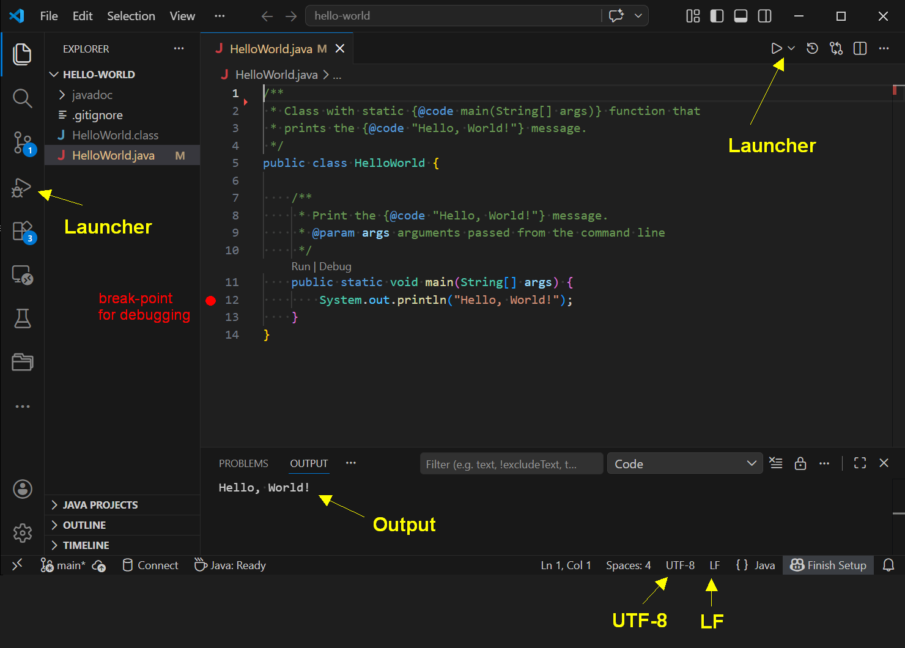
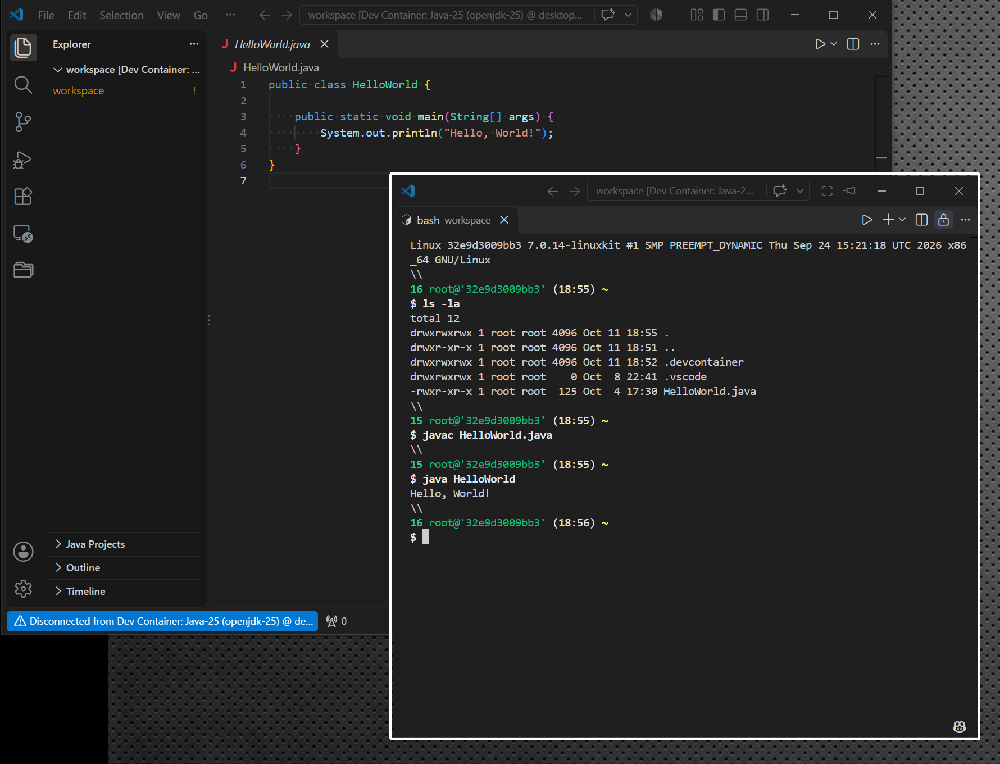
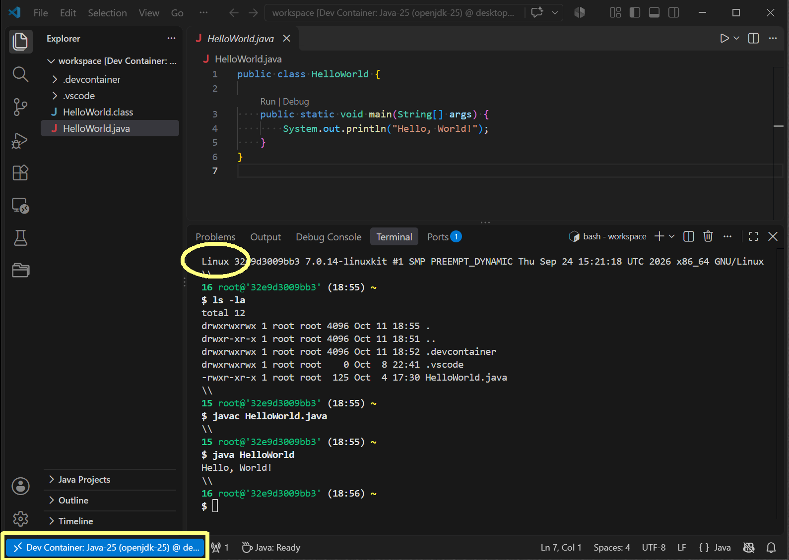
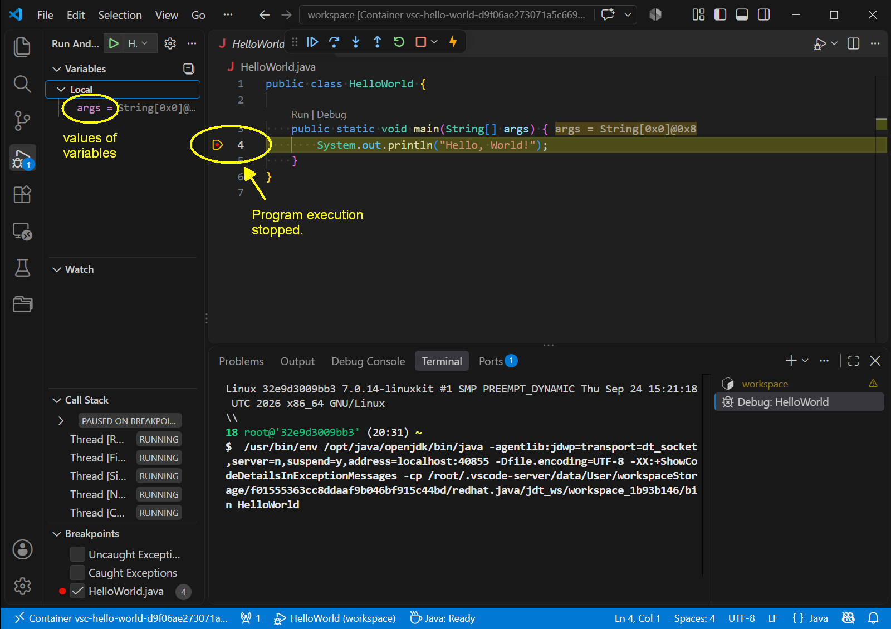

<!-- - - - - - - - - - - - - - - - - - - - - - - - - - - - - - - - - - - - -->
## A5: *VSCode* - Setup

[*Visual Studio Code (VSCode)*](https://code.visualstudio.com) is a modern,
popular *IDE* (Integrated Development Environment) by *Microsoft* with:

- support for multiple programming languages (*"polyglot"*).

- a large ecosystem of extensions (*plugins*, e.g. *"Java extension pack"*,
    *"Code Runner"*, *Dev Container*, various *AI* extensions, etc.).

- ability to develop in remote environments (cloud containers) over the network.

- built-in *AI integration* (Microsoft's *Co-Pilot*, *Claude*, etc.).


For this course, the following *VSCode* extensions are recommended:

- [*Extension Pack for Java*](https://marketplace.visualstudio.com/items?itemName=vscjava.vscode-java-pack)
    -- required for *Java* courses
    ([*Pyhon Extension*](https://code.visualstudio.com/docs/languages/python)
     for *Python* courses).

- [*Code Runner*](https://marketplace.visualstudio.com/items?itemName=formulahendry.code-runner)
    -- recommended.

- [*Dev Container*](https://code.visualstudio.com/docs/devcontainers/containers).


&nbsp;
---
### Setup

*VSCode* opens each project separately (not multiple projects at once,
which is in contrast to older *IDE* such as *eclipse*).

It is thus recommended to start *VSCode* from within the project directory
in a terminal. Verify that you can start *VSCode* from the terminal, e.g.
by setting *PATH* in `.bashrc`.

Navigate to the project directory and start *VSCode*:

```sh
cd ~/workspaces/hello-world     # cd to into the project directory

code .                          # start VSCode in the '.' (dot) current directory
```

*VSCode* will open the project and show project files.

Run the *HelloWorld* Program with:

- the internal *launcher* (see screenshot) or with

- [*Code Runner*](https://marketplace.visualstudio.com/items?itemName=formulahendry.code-runner)
    that runs code faster by the key command: `<Ctrl> + <Alt> + N`.

Output appears in the integrated Terminal panel.

&nbsp;




&nbsp;
---
### VSCode Paths

*VSCode* (by default) installs under the folloing paths:

```sh
Windows:    %APPDATA%/Local/Programs/Microsoft\ VS\ Code/bin
            APPDATA: C:/Users/<user>/AppData/Roaming
- example:  C:/Users/<user>/AppData/Roaming/Local/Programs/Microsoft\ VS\ Code/bin

MacOS:      /Applications/Visual\ Studio\ Code.app/Contents/Resources/app/bin
Linux:      often under: /usr/share/code or: /opt/code
```

*VSCode* internally chaches (makes copies of) projects where it compiles
code and writes logs. These *"project caches"* keep state of a *VSCode*
project and are supposed to be hidden and separate from the actual project
you see in the *VSCode* IDE.
This allows to keep project spaces clean and not cluttered with interim
or temporary files.

While this is good, sometimes it happens that strange effects happen in
a *VSCode* project. Then, the project cache should be cleaned and reset.

Project cache reset can occur in two steps:

1. *regular reset* -- by invoking `<Ctrl> + <Shift> + P` and (for Java)
    searching for *"Java: Clean Java Language Server Workspace"* and
    performing this action. This will rebuild the project cache and the
    project may work afterwards.

2. *hard reset* -- if a *regular reset* does not help, the project cache
    can be removed in the file system.

    Paths of project caches are:

    ```sh
    Windows:    %APPDATA%/Code/User/workspaceStorage
    - example:  C:/Users/<user>/AppData/Roaming/Code/User/workspaceStorage

    Mac:        $HOME/Library/Application\ Support/Code/User/workspaceStorage
    Linux:      $HOME/.config/Code/User/workspaceStorage
    ```

    Remove the (or all) project cache directory(ies) and restart *VSCode*.
    *VSCode* will rebuild the new project cache.


&nbsp;
---
### VSCode Settings

*VSCode* maintains configuration settings in `settings.json` files.
One (system-wide) settings file holds settings that apply to all projects
on the system. Projects can also hold specific project settings in
the project directory under `.vscode/settings.json`.

Locate the system-wide *VSCode* settings file on your system:

```sh
# VSCode global settings file and project caches:
Windows:    %APPDATA%/Code/User
- example:  C:/Users/<user>/AppData/Roaming/Code/User

MacOS:      $HOME/Library/Application\ Support/Code/User

Linux:      $HOME/.config/Code/User/settings.json
```

Locate your system-wide *VSCode* settings file and understand settings.
Add usefull settings, particularly for turning-on *auto-save* and using
*UTF-8* and *"\n"* *(NL)* as default new line character. Review other
settings and choose those that are suitable for you.

```json
{
    // General settings
    "explorer.confirmDelete": false,        // ask to comfirm file delete
    "files.autoSave": "afterDelay",         // 'afterDelay' (1sec), 'onFocusChange', 'onWindowChange'
    "files.autoSaveDelay": 800,
    "files.eol": "\n",                      // use '\n' as default line ending
    "files.associations": {                 // chose syntax highlighting by file endings
        "*.rc": "shellscript",
        "*.path": "shellscript",
        "**/.termrc": "shellscript"
    },
    "terminal.integrated.hideOnStartup": "always",  // prevent terminal showing-up at startup
    "explorer.confirmDelete": false,        // ask to comfirm when deleting files
    "files.autoSave": "afterDelay",         // 'afterDelay', 'onFocusChange', 'onWindowChange'
    "files.autoSaveDelay": 800,
    "files.eol": "\n",                      // use '\n' as default line ending (not: CR/LF)
    "redhat.telemetry.enabled": false,      // don't collect telemetry data
    "testing.resultsView.layout": "treeLeft", // appearance of test results

    // Appearance and assistance settings
    "workbench.colorTheme": "Dark Modern",
    "chat.viewSessions.orientation": "stacked",
    "github.copilot.nextEditSuggestions.enabled": false,
    "github.copilot.enable": {
        "*": false,
        "plaintext": false,
        "markdown": false,
        "scminput": false,
        "java": false
    },
    "geminicodeassist.inlineSuggestions.enableAuto": true,
    // "window.zoomLevel": 1,

    // Editor settings
    "editor.detectIndentation": false,
    "editor.tabSize": 4,
    "editor.insertSpaces": true,            // insert spaces for tabs
    "editor.renderWhitespace": "all",       // show white spaces in editor as small dots
    "editor.hover.enabled": "on",           // show context when hovering
    "editor.hover.delay": 1500,             // delay hover-time for context pop-ups (in ms)
    "editor.minimap.enabled": false,        // show minimap for long files
    "editor.inlayHints.enabled": "off",     // don't show argument names in method calls

    // Terminal settings, see https://code.visualstudio.com/docs/terminal/profiles
    "terminal.integrated.defaultProfile.windows": "Bash",
    "terminal.integrated.profiles.windows": {
        "Bash": {
          "path": ["bash"],
          //"args": ["--init-file", "'${workspaceFolder}'/.vscode/launch_terminal.sh"],
          "args": ["--init-file", "~/.profile"],
          "icon": "terminal-bash",
        },
        "PowerShell": null,                 // remove other terminals from the menu
        "cmd.exe": null,                    // unless you want them
        "Git Bash": null,
        "Command Prompt": null,
        "Ubuntu (WSL)": null,
    },

    // Docker settings (extension)
    "docker.commands.attach": "${containerCommand} exec -it ${containerId} ${shellCommand}",
    "containers.commands.attach": "${containerCommand} exec -it ${containerId} ${shellCommand}",
}
```

Project-specific settings overrule system-wide settings in a project. They
are stored in the project directory under: `.vscode/settings.json`.
Review settings for a *Java* project as an example:

```json
{
    // Code Runner settings
    "code-runner.defaultLanguage": "java",
    "code-runner.clearPreviousOutput": true,
    "code-runner.saveAllFilesBeforeRun": true,
    "code-runner.runInTerminal": true,  // avoid UTF-8 problem in OUTPUT console on Windows
    "code-runner.executorMap": {
        "java": "javac HelloWorld.java && java HelloWorld",
        "vmArgs": "-Dfile.encoding=UTF-8"
    },

    // Project Java settings
    "java.configuration.updateBuildConfiguration": "automatic",
    "java.debug.settings.onBuildFailureProceed": true,
    "java.debug.settings.showHex": true
}
```


&nbsp;
---
### Advanced Editing

[*Multi-cursor*](https://code.visualstudio.com/docs/editing/codebasics)
editing is an advanced method to quickly perform edits at multiple
locations at the same time.

Set multiple cursors by:

```
<Ctrl> + <Alt> + <Cursor-Up/-Down>

<Alt> + <Click>
```

Block-comment multiple lines by:

```
mark text and <Click> + '#'
```


&nbsp;
---
### Detach the integrated terminal using Key-bindings

*Detaching a terminal* disconnects the terminal from the main *VSCode* panel
and launches a separat window.

*Key-bindings* are sequences of key strokes that can be defined to quickly
perform actions. Custom key-bindings are stored in a file: `keybindings.json`
that is stored with the system-wide or project `settings.json` files.

The following `keybindings.json` file holds bindings for actions:

- *detach terminal* (`workbench.action.terminal.moveIntoNewWindow`)
    by: `<Ctrl> + <t> + <Ctrl> + <d>`,

- *attach terminal* (`workbench.action.terminal.moveToTerminalPanel`)
    by: `<Ctrl> + <t> + <Ctrl> + <a>`.

Add these key-bindings to *VSCode*:

```
^K + ^S -- opens keybindings, search for: "Terminal: Move"

add key-bindings:
- ^T + ^D - detach terminal
- ^T + ^A - re-attach terminal back into the VSCode IDE
```

Verify settings in the system-wide `settings.json` file. The file should
contain the key-bindings:

```json
// Place your key bindings in this file to override the defaults
// - https://code.visualstudio.com/docs/getstarted/keybindings
[
    {
        "key": "ctrl+t ctrl+d",
        "command": "workbench.action.terminal.moveIntoNewWindow"
    },
    {
        "key": "ctrl+t ctrl+a",
        "command": "workbench.action.terminal.moveToTerminalPanel"
    }
]
```

Use key-bindings and detach the terminal. The terminal now shows with its
own window.



Re-attaching brings the terminal back into the IDE.


&nbsp;
---
### VSCode Dev-Container

Read article
[*Devcontainers for VSCode: Setting Up Reproducible Development Environments*](https://www.mironsoft.de/en/blog/docker-setting-up-devcontainers-for-vs-code)
and understand the purpose and value of *VSCode Development (Dev-)Containers*.

The main advantage of *VSCode Dev-Container* is to
*unify the development environment* in a software development team. All
developers use exactly the same tools, same versions and same operating
system in own container instances.

File [*.devcontainer/devcontainer.json*](https://github.com/sgra64/dev-container-java/blob/main/devcontainer.json)
(*Java*) in the project directory provides a *specification* that exactly
defines the container used for development. Based on it, *VSCode* creates
the container with exactly the specified content for every software developer
using the *dev-container* (see
[*devcontainer.json*](https://github.com/sgra64/dev-container-python/blob/main/devcontainer.json)
for *Python*).

*VSCode* recognizes the presence of a `.devcontainer` directory in a project
when it starts and creates the specified *dev-container* or connects to an
existing one using file `devcontainer.json`. The container may be local
(on the laptop) or may be remote, e.g. run in a *Cloud* data center.

*VSCode* then connects the IDE to the container. Edits, compiles, debugs are
performed in the container appearing as they were local. Terminal-shells
execute in the container and hence show the container environment (not the
local laptop environment).

Using *VSCode Dev-Container* requires

- the *VSCode IDE* with the

- [*Dev Containers plugin*](https://marketplace.visualstudio.com/items?itemName=ms-vscode-remote.remote-containers)
    and

- *Docker*, e.g. *Docker-for-Desktop*

installed on your laptop.


&nbsp;
---
### Build and Run a Dev-Container

<!-- 
CONTAINER_NAME="dev-container-openjdk25"
TARGET_PATH="/workspace"
HEX_NAME=$(echo -n "$CONTAINER_NAME" | xxd -p | tr -d '\n')
code --folder-uri "vscode-remote://attached-container+${HEX_NAME}${TARGET_PATH}"
code --folder-uri vscode-remote://attached-container+6465762d636f6e7461696e65722d6f70656e6a646b3235
 -->

Inspect directory
[*.devcontainer*](https://github.com/sgra64/dev-container-java) for *Java* (use
[*.devcontainer*](https://github.com/sgra64/dev-container-python) for *Python*)
and include content into the `hello-world` project.

(Re-)start *VSCode* in the project. *VSCode* recognizes the presence of
the `.devcontainer` directory and creates and launches the container
with the specified content.

In case of *Java*, image
[*eclipse-temurin:25-jdk*](https://hub.docker.com/hardened-images/catalog/dhi/eclipse-temurin/images?orderBy=last-pushed&order=desc&pageSize=100)
is pulled from the global [*hub.docker*](https://hub.docker.com) registry.
In case of *Python*, image
[*python:3.12-slim*](https://hub.docker.com/_/python)
is referred to as *base image* in the
[*Dockerfile*](https://github.com/sgra64/dev-container-python)
that is used for building the image for the container. The container is
created with this image.

*Docker* shows running containers based on these images:

- *"dev-container-openjdk25"* for the *Java* dev-container and

- *"dev-container-python312"* for the *Python* dev-container.

When *VSCode* is ready, open a terminal and compile and run the code. Make
sure you see `Linux ...` running in the terminal connected to the container.
The status of the conntection to the dev-container is shown in the lower
left corner.



(see for the [*Python container*](../markup/img/vscode-3-devcontainer-helloworld-python.png)).

The indicator in the lower-left corner shows that *VSCode* is connected to the
Dev-container.


&nbsp;
---
### Validation

In order to collect points, show *VSCode* on your laptop with following settings
turned-on:

1. `UTF-8` is turned on.

1. `LF` is turned on, not `CR/LF`.

1. Start *VSCode* and connect to the *dev-container*.

    <!-- 
    1. Set a break-point at the line with `System.out.println()` as shown in the
        first figure of this page and launch the *"Hello, World!"* program in debug
        mode. Program execution stops at this line.

        

    &nbsp;
    -->

1. Detach the terminal with: `^T + ^D`, compile and run *"Hello, World!"* in the
    detached terminal.

    

    &nbsp;

1. Open your system-wide *VSCode* `settings.json` file and show you have turned *autosave* on
    and use `LF` (Unix) as line ending:

    ```json
    {
        "files.autoSave": "afterDelay",     // auto-save after 800ms
        "files.autoSaveDelay": 800,         // 
        "files.eol": "\n",                  // use '\n' as default line ending (not: CR/LF)
        // ...
    }
    ```
